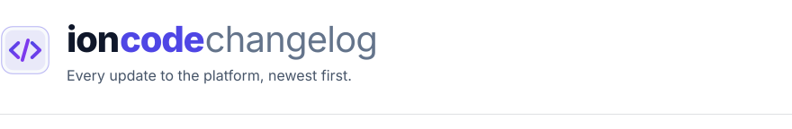

<picture>
  <source media="(prefers-color-scheme: dark)" srcset="assets/banner-dark.svg">
  
</picture>

Release notes for [ioncode](https://ioncoden.web.app), the cloud IDE and developer community. Versions follow [semantic versioning](https://semver.org), and each release lists what was added, changed, fixed, or removed.

 

## v1.0.0

November 15, 2026

The first release of the ioncode workspace.

### Added

**Cloud IDE**

- Multi-tab Monaco editor with files open side by side
- Version checkpoints, with diffs against previous checkpoints
- Built-in code snippets
- Live preview for HTML and Markdown
- Auto-save
- 216 curated editor themes
- Command palette, opened with `Ctrl K`

**Discussions**

- Real-time channels and 1-on-1 direct messages
- Formatted code blocks in messages
- Interactive polls

**Showcase and profiles**

- Publish projects to Explore
- Remix community projects with full attribution
- Developer heatmap and badge collection

 

---

Built for developers, by developers.
